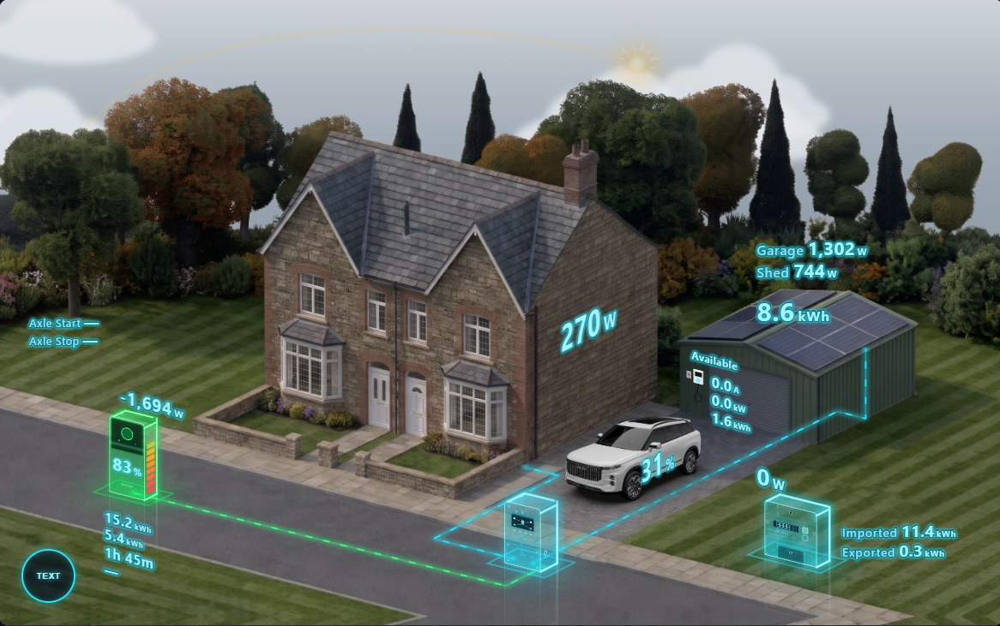
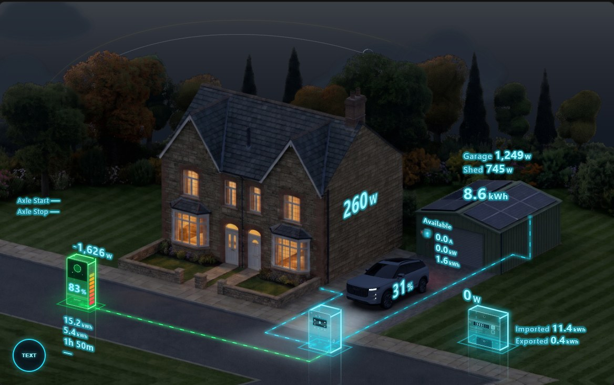
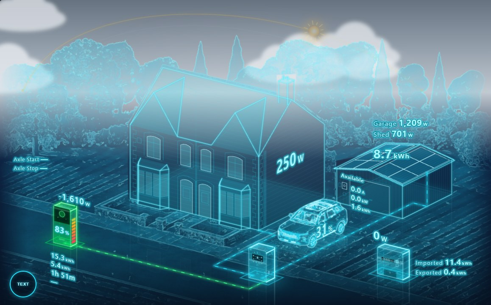
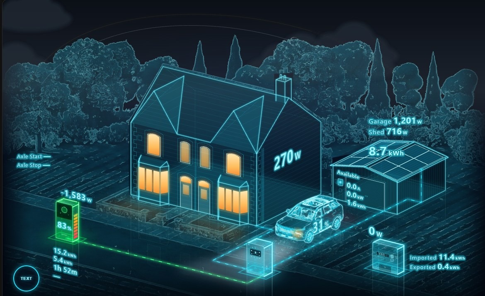

# Baugh Home Card

[](https://www.buymeacoffee.com/boffy35)

An animated home-energy scene for Home Assistant dashboards. A house, garage, car, battery, inverter and meter are shown in 3D, with animated power flows between them for solar, battery, grid, house load and EV charging. The sky follows the real sun, moon and weather, so the scene changes between day and night, clouds, rain, snow, fog and storms.

| Realistic, day | Realistic, night |
| :---: | :---: |
|  |  |
| **Hologram, day** | **Hologram, night** |
|  |  |

## Features

- **Two views:** a realistic photo scene, or a glowing cyan hologram.
- **Live power flows** for solar, battery charge and discharge, grid import and export, house load and EV charging. Flows only show when the power is above a threshold you set.
- **Real sky:** the sun and moon move across the sky using your Home Assistant location, with stars at night and an automatic day/night switch.
- **Weather effects** from any weather entity: sun, cloud, rain, heavy rain, snow, fog and lightning.
- **Battery state of charge** shown on each battery, colour-coded from red to green. Supports one or two batteries.
- **EV charger status**, with friendly names for OCPP states such as "Plugged in" and "Paused by car".
- **Axle VPP events:** the scene pulses during an Axle event, and from a set time before it starts.
- **Text overlays** for power, energy, time to full or empty, charger figures and more. Each block can be moved, resized and relabelled, and a button on the card shows or hides them.
- **Tap anything** (house, battery, inverter, meter, car or garage) to open its entity.
- **Visual editor**, which also suggests entities from your system when you first add the card.

## Installation

### HACS (recommended)

1. Open **HACS** in Home Assistant.
2. Open the **⋮** menu (top right) and choose **Custom repositories**.
3. Add `https://github.com/Boffy35/baugh-home-card` with the type **Dashboard**.
4. Search for **Baugh Home Card** in HACS and download it.
5. Hard-refresh your browser (Ctrl + F5, or Cmd + Shift + R on a Mac).

HACS installs the card together with all its images.

### Manual

1. Download every file in the [`dist`](dist) folder: `baugh-home-card.js`, the `.svg` files and the three `photo-*.webp` files.
2. Copy them all into `/config/www/baugh-home-card/`. The images must stay in the same folder as the `.js` file.
3. Go to **Settings → Dashboards → ⋮ → Resources → Add resource** and enter:
   - URL: `/local/baugh-home-card/baugh-home-card.js?v=1`
   - Resource type: **JavaScript module**
4. Hard-refresh your browser.

If the card says images can't be found, check that all the files are beside `baugh-home-card.js`, or point `asset_path` at the folder that holds them.

## Usage

Edit a dashboard, choose **Add card** and pick **Baugh Home**. The visual editor fills in likely entities from your system, and you can change any of them.

Every entity is optional; anything you leave out simply isn't shown. A minimal example:

```yaml
type: custom:baugh-home-card
pv_power: sensor.pv_power
load_power: sensor.house_load
grid_power: sensor.grid_power
battery_power: sensor.battery_power
battery_soc: sensor.battery_soc
weather: weather.home
```

A full example, with a Solis inverter, two batteries, a Sync EV charger and Axle events, is in [`examples/card-config.yaml`](examples/card-config.yaml).

## Options

### General

| Option | Default | Description |
| --- | --- | --- |
| `view` | `realistic` | `realistic` (photo scene) or `hologram`. |
| `day_night` | `auto` | `auto` follows the sun, or set `day` or `night` to fix it. |
| `sun_entity` | `sun.sun` | Sun entity used for the sun's position. |
| `weather` | — | Weather entity that drives the sky effects. |
| `house_facing` | `45` | Compass direction the front of the house faces, in degrees, so the sun and moon appear in the right place. |
| `threshold` | `20` | Power in watts below which a flow is treated as off. |
| `show_text` | `true` | Show the text overlays. The button on the card toggles this per browser. |
| `battery_count` | `2` | `1` or `2` batteries. |
| `battery_soc_text_size` | `1` | Size of the charge-level text on the batteries. |
| `invert_battery` | `false` | Flip the battery power sign if charging shows as discharging. |
| `invert_grid` | `false` | Flip the grid power sign if import shows as export. |
| `asset_path` | card folder | Folder holding the images, if they aren't beside the `.js` file. |
| `title` | — | Gives the card its own name. Use it if you have more than one Baugh Home Card, so each remembers its own text setting. |

### Entities

| Option | Description |
| --- | --- |
| `pv_power` | Total solar power (W or kW). |
| `pv1_power`, `pv2_power` | Power of each solar string. |
| `pv_energy_today` | Solar energy generated today. |
| `load_power` | House load power. |
| `grid_power` | Net grid power: positive for import, negative for export. |
| `grid_import_power`, `grid_export_power` | Used instead of `grid_power` if you only have separate import and export sensors. |
| `grid_import_energy`, `grid_export_energy` | Energy imported and exported today. |
| `battery_power`, `battery2_power` | Battery power: positive when charging. Use `invert_battery` if yours is the other way round. |
| `battery_soc`, `battery2_soc` | Battery state of charge (%). |
| `battery_charge_energy`, `battery_discharge_energy` | Battery energy charged and discharged today (also `battery2_…`). |
| `battery_time_to_full`, `battery_time_to_empty` | Time remaining, as minutes, `h:mm` or a timestamp (also `battery2_…`). |
| `car_soc` | Car battery level (%). |
| `ev_power` | EV charging power. |
| `charger_status` | Charger connector status, such as an OCPP status sensor. |
| `charger_current` | Charging current (A). |
| `charger_session_energy` | Energy delivered this charging session. |
| `axle_event` | An on/off entity that is on during an Axle event. |
| `axle_start`, `axle_end` | Axle event start and end times. |
| `axle_lead` | Minutes before an Axle event starts that the pulse begins (default `60`). |

### A second battery

Set `battery_count: 2` and add the `battery2_…` entities. The second battery appears beside the first in the scene, with its own charge level, power flow and text blocks (`battery2_power` and `battery2`). If you leave out `battery2_power` or `battery2_soc`, it mirrors the first battery's values.

### Moving things: `layout`

`layout` moves and resizes the car, battery, inverter and meter in the scene. Each takes `x`, `y` and `scale`. The battery, inverter and meter also take `o: front` (facing the street) or `o: gable` (facing the side of the house). The house and garage are fixed.

```yaml
layout:
  battery:  { x: 0.6,  'y': -10.3, scale: 3.05 }
  inverter: { x: 14.1, 'y': -8.1,  scale: 4, o: gable }
```

### Text blocks: `text` and `labels`

Each text block can be moved with `x` and `y` (as a percentage of the card's width and height), resized with `size`, and drawn `or: front`, `or: side` or `or: flat` to match the scene's angles.

The blocks are `meter_power`, `meter_energy`, `pv_strings`, `pv_total`, `battery1_power`, `battery1`, `battery2_power`, `battery2`, `house_load`, `car_soc`, `charger_status`, `charger` and `axle`.

```yaml
text:
  house_load: { 'y': 56.5, size: 2.1 }
  pv_total:   { x: 75.5, 'y': 51.5, size: 1.45, or: flat }
```

`labels` adds a label in front of any value, using the entity option's name:

```yaml
labels:
  pv1_power: Garage
  pv2_power: Shed
  grid_import_energy: Imported
```

Put `y` in quotes (`'y'`) in YAML, because a bare `y` can be read as "yes".

## Support

If you find this card useful, you can [buy me a coffee](https://www.buymeacoffee.com/boffy35). Thank you!

## Licence

MIT, see [LICENSE](LICENSE).
